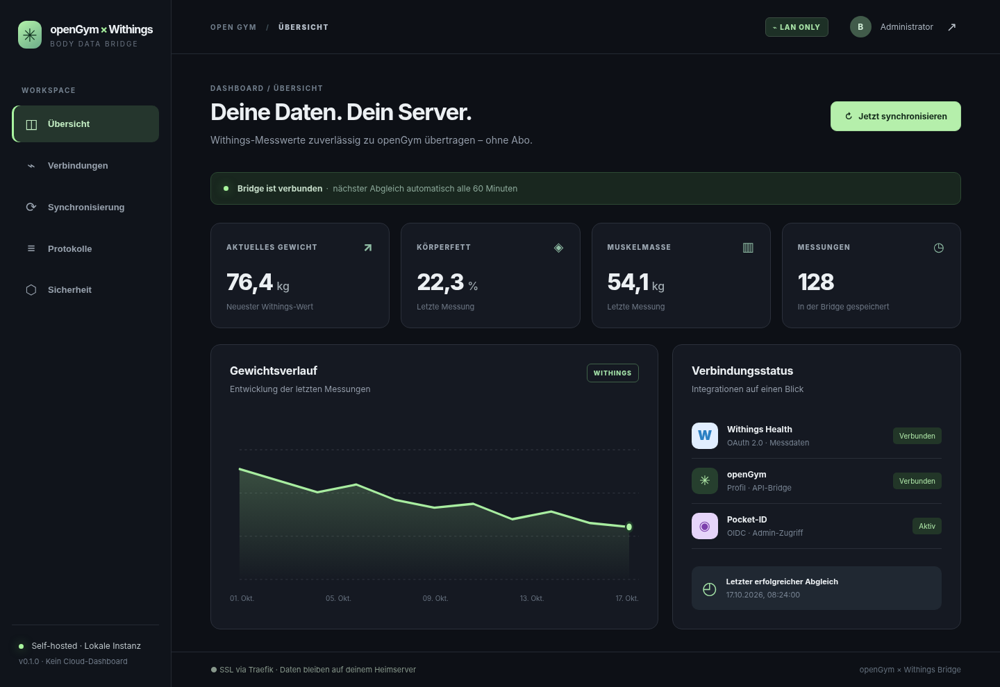
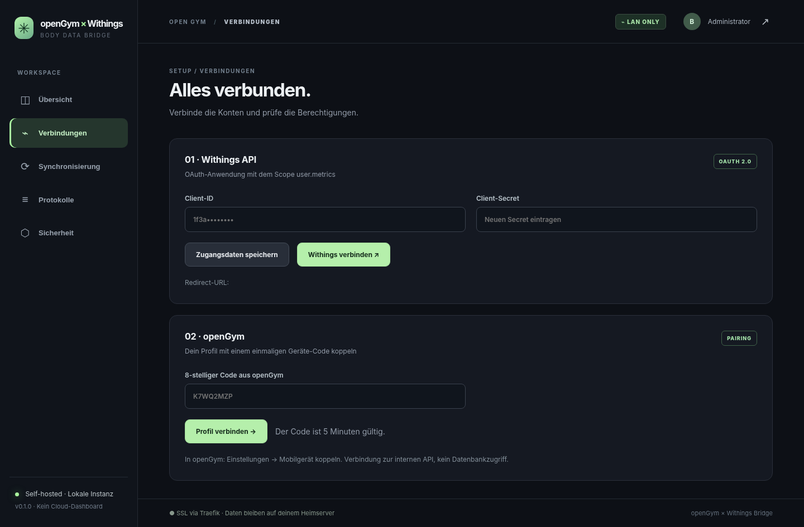
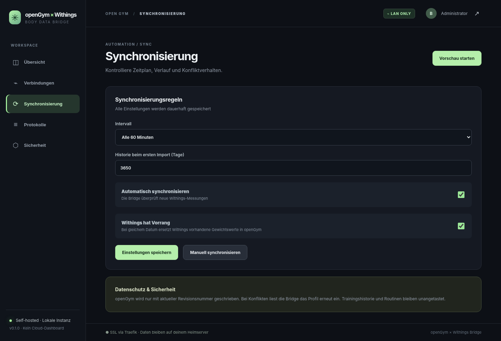
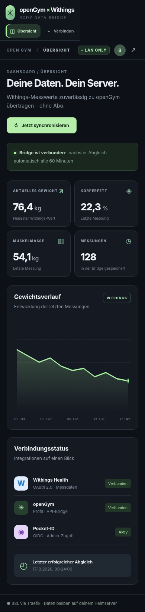
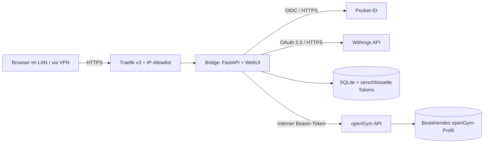

<div align="center">

# openGym × Withings

**Deine Withings-Messwerte. Dein openGym-Profil. Dein Heimserver.**

Eine selbst gehostete Bridge mit deutscher Weboberfläche, Pocket-ID-Anmeldung und automatischer Übertragung von Körpergewicht aus Withings nach openGym – ohne zusätzlichen SaaS-Dienst.

`Withings API` → `lokale SQLite-Datenbank` → `openGym API`



[Installation](#installation-auf-dem-heimserver) · [Einrichtung](#einrichtung-in-der-webui) · [Funktionsweise](#so-funktioniert-die-synchronisierung) · [Sicherheit](#sicherheit-und-datenschutz) · [Fehlerbehebung](#fehlerbehebung)

</div>

> [!IMPORTANT]
> **Entwicklungsstand: v0.1 / Review-Build.** Die Oberfläche und automatisierte Tests sind erstellt. Die Verbindung zu deinem *echten* Withings-, Pocket-ID- und openGym-Konto sowie das Deployment auf deinem Server wurden noch **nicht** durchgeführt. Vor der Verwendung mit echten Gesundheitsdaten zuerst Backup erstellen, eine Vorschau ausführen und das Verhalten prüfen.
>
> **Alle Screenshots enthalten ausschließlich synthetische Demodaten.** Sie wurden direkt aus den mitgelieferten WebUI-Dateien gerendert, nicht aus einem echten Withings-Konto.

## Funktionen

| Feature | Stand | Verhalten |
|---|---|---|
| Withings OAuth 2.0 | Implementiert, nicht live verifiziert | Verknüpfung per Browser, Access-/Refresh-Tokens verschlüsselt gespeichert |
| Pocket-ID OIDC | Implementiert, nicht live verifiziert | Anmeldung mit ID-Token-Prüfung, Nonce, State und Gruppenfreigabe |
| Deutsche WebUI | Implementiert | Dashboard, Kontoverknüpfung, Regeln, Protokolle, OIDC-Einstellungen |
| Automatische Synchronisierung | Implementiert | Standard **alle 60 Minuten**, nach erfolgreicher Verbindung einschaltbar |
| Withings-Vorrang | Implementiert | Bei gleichem Datum wird das **openGym-Gewicht durch Withings ersetzt** |
| Synchronisationsvorschau | Implementiert | Berechnet geplante Änderungen vor dem Schreiben |
| openGym-Pairing | Implementiert | Verwendet den 8-stelligen einmaligen Geräte-Pairing-Code |
| Schreibkonflikte | Implementiert | `GET /api/data` → `PUT /api/data` mit `baseRev` und Wiederholungen bei HTTP 409 |
| Körperzusammensetzung | Lokal gespeichert | Körperfett, Fettmasse, Muskelmasse, fettfreie Masse, Hydration, Knochenmasse werden in SQLite erfasst |
| Körpergewicht in openGym | Implementiert | Ein Eintrag pro Tag in `bodyweight` (openGym-Format `d`, `w`, `t`) |
| Responsive UI | Implementiert | Desktop, Tablet und Smartphone |
| Nur intern | Per Compose konfiguriert | Split-DNS **plus** Traefik-IP-Allowlist, kein Hostport veröffentlicht |

**Absichtlich nicht Teil von v0.1:** Änderungen am openGym-Quellcode, direktes Schreiben in dessen Datenverzeichnis, Live-Webhooks von Withings oder die Übertragung der Körperzusammensetzungswerte in nicht vorhandene openGym-Felder.

## Screenshots der WebUI

### Übersicht


Das Dashboard zeigt die letzten Messwerte, Gewichtsverlauf, Konto-Verbindungen und den letzten Abgleich. Änderungen erscheinen nach erfolgreicher Synchronisierung automatisch auf der Seite.

### Kontoverbindungen



Withings wird über Client-ID/Secret und den offiziellen OAuth-Dialog verbunden. Die openGym-Verbindung erfolgt über einen kurzlebigen Pairing-Code, nicht über einen kopierten Datenbankzugang.

### Synchronisierung



Einfaches Intervall, historische Importspanne, Start/Stopp, **Withings hat Vorrang** und Vorschau lassen sich in der Oberfläche einstellen.

### Smartphone



Die Oberfläche ist responsiv. Sie ist **keine eigenständige iOS-App** und benötigt keinen Zugriff auf Apple Health.

---

## Architektur



Das Programm benötigt **keinen externen Callback-Server**: Beide OAuth-Weiterleitungen führen über deinen Browser zur internen Webadresse zurück. Die Callback-Regeln des jeweiligen Providers müssen trotzdem geprüft werden (see [Withings](#3-withings-entwickleranwendung-anlegen)). It does not open TCP ports on the host.

### Serververzeichnisse

```text
/mnt/docker/compose/openGym-Withings/     # Git-Repository, Compose, Anwendung
/mnt/docker/appdata/opengym-withings/   # SQLite und verschlüsselte Geheimnisse
  ├── bridge.db
  ├── fernet.key
  ├── session.key
  └── setup.key
```

Die persistenten Dateien unter `/mnt/docker/appdata/opengym-withings` gehören in dein reguläres Server-Backup. **`fernet.key` und `bridge.db` müssen gemeinsam gesichert werden** – ohne Schlüssel sind die verschlüsselten OAuth-Tokens nicht mehr lesbar.

## Voraussetzungen

- Ubuntu Server 24.04, Docker und Docker Compose Plugin.
- Bestehender Traefik v3 mit Docker-Provider, Netzwerk `proxy` und Zertifikatsresolver `cloudflare`.
- Bestehendes openGym mit Docker-Netzwerk `opengym_backend` und Container `opengym-api-1` (HTTP-Port 3000).
- Pocket-ID unter `https://id.glockb.de`.
- Withings-Account sowie **eine eigene Withings-Entwickleranwendung** mit Client-ID und Client-Secret. Kontozugang allein reicht nicht.
- Internes DNS, das `opengym-withings.home.glockb.de` auf **192.168.1.23** auflöst.
- Docker-Nutzer mit Schreibrechten für **nur** `/mnt/docker/appdata/opengym-withings`.

> [!NOTE]
> Die Nutzbarkeit der Withings-API und eventuelle Voraussetzungen des Herstellerprogramms liegen bei Withings. Bei deinem älteren Konto könnten Bestandsschutzregelungen gelten, sie ersetzen aber nicht zwingend die Freigabe deiner Entwickleranwendung. Wir garantieren keine Withings-API-Freischaltung ohne vorherigen echten Test.

## Installation auf dem Heimserver

**Befehle direkt auf dem Ubuntu-Server eingeben**, nicht auf dem Mac.

```bash
cd /mnt/docker/compose

git clone https://github.com/Baodor/openGym-Withings.git
cd openGym-Withings

# Falls du den Feature-Branch vor dem Merge testest:
# git switch feat/withings-bridge-mvp

cp .env.example .env

# Docker-Compose-Umgebung prüfen
nano .env

bash scripts/install.sh
```

Die Installation erstellt nur das Bridge-Appdata-Verzeichnis, baut das eigene Image und startet **ausschließlich die Bridge**. Es gibt **kein `chown -R`**, kein `docker compose down` anderer Projekte und keine Migration von openGym.

### Dateirechte

Der Container läuft standardmäßig mit UID/GID `1000:1000` (Baodor). Das Appdata-Verzeichnis sollte dem Benutzer gehören, der das Installationsskript startet. Für abweichende Benutzer `PUID`/`PGID` in `.env` setzen. Keine breiten Berechtigungsänderungen an `/mnt/docker`, Datenbanken oder Nextcloud vornehmen.

### Docker-Netzwerke kontrollieren

```bash
docker network inspect proxy --format '{{.Name}}'
docker network inspect opengym_backend --format '{{.Name}}'
docker inspect opengym-api-1 --format '{{range $n,$x := .NetworkSettings.Networks}}{{println $n}}{{end}}'
```

Ist das zweite Netzwerk abweichend benannt, `OPENGYM_BACKEND_NETWORK` in `.env` entsprechend einstellen. Die interne API-Adresse muss **`http://opengym-api-1:3000`** bleiben. Das Programm lässt keine frei editierbaren API-Zielhosts zu, um SSRF über die WebUI zu verhindern.

## Interne Erreichbarkeit

| Einstellung | Wert |
|---|---|
| URL | `https://opengym-withings.home.glockb.de` |
| DNS | Pi-hole Local DNS Record → `192.168.1.23` |
| Traefik-Router | `opengym-withings@docker` |
| EntryPoint | `websecure` |
| Certresolver | `cloudflare` (Cloudflare DNS-01) |
| Hostport | **Keiner** |
| IP-Allowlist | `192.168.1.0/24`, `100.64.0.0/10` (bei Bedarf anpassen) |

Das Zertifikat kann per DNS-01 angefordert werden, auch wenn die Subdomain keinen öffentlichen A-Record hat. **Keinen öffentlichen Cloudflare-A-/AAAA-Record für diesen Dienst anlegen.**

**Wichtig:** Ein `.home.glockb.de`-Name ist nicht automatisch privat. Die Bridge wird zusätzlich von Traefiks `ipAllowList` beschränkt. Falls du über ein anderes VLAN (z. B. `192.168.10.0/24`) zugreifen möchtest, `ALLOWED_CIDRS` **bewusst** erweitern und den tatsächlichen Quell-IP-Pfad prüfen. Ein vorgeschalteter öffentlicher VPS-/WireGuard-Proxy darf nicht versehentlich durch die Allowlist freigeschaltet werden. Bei Zugriff über das Internet den Quell-IP-/Forwarded-Header-Pfad zunächst mit Traefik-Logs prüfen.

```bash
# DNS intern testen
getent hosts opengym-withings.home.glockb.de

# Traefik-Route direkt am Host prüfen
curl -sS -o /dev/null \
  --resolve opengym-withings.home.glockb.de:443:192.168.1.23 \
  -w 'HTTP %{http_code}\n' \
  https://opengym-withings.home.glockb.de/
```

**Kein `-k`** im regulären Test; ein Zertifikatfehler muss behoben werden, nicht dauerhaft ignoriert.

## Einrichtung in der WebUI

### 1. Setup-Code

Beim ersten Start wird ein zufälliger Setup-Code als Datei angelegt:

```bash
cat /mnt/docker/appdata/opengym-withings/setup.key
```

Den Code **nur lokal** in der WebUI unter `https://opengym-withings.home.glockb.de` eingeben. Nicht in ein Issue, nicht in GitHub, nicht in einen Chat kopieren.

Sobald der OIDC-Client eingerichtet wurde, ist der Bootstrap-Endpunkt gesperrt.

### 2. Pocket-ID für OIDC einrichten

1. Pocket-ID öffnen: `https://id.glockb.de` → Administration → OIDC Clients → Neuer Client.
2. **Confidential Client** (nicht Public Client) erstellen.
3. Erlaubte Redirect-URL exakt eintragen:

   ```text
   https://opengym-withings.home.glockb.de/auth/oidc/callback
   ```

4. Scopes: `openid profile email groups`.
5. Unter **Access** die zugelassene Benutzergruppe auswählen (z. B. `admin`).
6. Client-ID und Client-Secret zusammen mit Issuer `https://id.glockb.de` und erlaubter Gruppe `admin` im einmaligen Setup-Formular speichern.
7. Nach dem ersten erfolgreichen OIDC-Login erscheinen die Admin-Reiter. Die Gruppe muss im signierten ID-Token enthalten sein; ein fehlendes `groups`-Claim wird nicht automatisch als Admin interpretiert.

Das OIDC-Secret wird verschlüsselt gespeichert. In der UI wird es nach dem Speichern nicht wieder im Klartext angezeigt. Eine Änderung der OIDC-Gruppe sperrt Benutzer ohne Gruppenmitgliedschaft beim nächsten Login aus; Änderungen zuerst mit einer zweiten Browser-Sitzung testen.

### 3. Withings-Entwickleranwendung anlegen

1. Im [Withings Developer/Partner Hub](https://developer.withings.com/) eine Anwendung erstellen.
2. Callback/Redirect-URL eintragen:

   ```text
   https://opengym-withings.home.glockb.de/auth/withings/callback
   ```

3. Benötigter Scope: `user.metrics`.
4. Client-ID und Client-Secret in der Bridge unter **Verbindungen → Withings API** speichern.
5. **Withings verbinden** klicken und die Freigabe in Withings bestätigen.
6. Der Browser muss beim OAuth-Callback über Split-DNS dein internes Ziel erreichen können (im LAN oder via VPN).

> [!WARNING]
> Der Withings-Autorisierungscode ist zeitkritisch. Das Fenster zur Bestätigung möglichst ohne Unterbrechung abschließen. Ob Withings die ausschließlich intern auflösbare Callback-Domain bei deiner konkreten Entwickleranwendung akzeptiert, wurde noch nicht live getestet. Falls die Registrierung dort abgelehnt wird, keine öffentliche Dauerfreigabe improvisieren: zuerst die vom Provider erlaubten Callback-Alternativen prüfen.

### 4. openGym-Profil verbinden

1. `https://gym.glockb.de` öffnen und mit deinem Passkey anmelden.
2. Unter Einstellungen die Option **Gerät koppeln / Pair mobile app** öffnen.
3. Den 8-stelligen Code in der Bridge unter **Verbindungen → openGym** eingeben.
4. Die Bridge tauscht den Code einmalig gegen einen Bearer-Token und liest zur Kontrolle `/api/me`.

Die Bridge verändert **weder den openGym-Container noch die Passkeys**. Der Token kann in openGym über **Auf allen Geräten abmelden** widerrufen werden; dann muss die Bridge neu gekoppelt werden.

### 5. Synchronisierung freigeben

Unter **Synchronisierung**:

| Option | Empfohlener Wert |
|---|---|
| Intervall | **60 Minuten** |
| Historie beim ersten Mal | 3650 Tage (bei Bedarf reduzieren) |
| Automatisch synchronisieren | Nach erfolgreichem Test aktivieren |
| Withings hat Vorrang | **Ja** |

**Zuerst auf „Vorschau starten“ klicken.** Anschließend einen manuellen Sync durchführen. Erst wenn Gewichtsverlauf und vorhandene Trainingsdaten geprüft sind, den automatischen Sync einschalten.

## So funktioniert die Synchronisierung

1. Withings-API liefert Messgruppen über `POST /v2/measure` (`getmeas`).
2. Die Bridge skaliert `value × 10^unit` in physikalische Einheiten und speichert Messungen anhand der Withings-Gruppen-ID.
3. Für das Körpergewicht wird pro Kalendertag (Zeitzone `Europe/Berlin`) die **neueste Messung** ausgewählt.
4. Die Bridge liest über `GET /api/data` den **vollständigen** openGym-Profilstand einschließlich Revisionsnummer.
5. Für Tage mit vorhandenem Gewicht wird der Betrag ersetzt (**Withings bevorzugt**); Tage ohne Gewicht werden ergänzt.
6. `PUT /api/data` verwendet `baseRev`. Bei HTTP 409 werden Daten neu gelesen und der Merge bis zu viermal neu berechnet. Es gibt **keinen** unbedingten Überschreibvorgang.
7. Nach Erfolg speichert die Bridge den Sync-Zeitstempel; nächste planmäßige Prüfung nach 60 Minuten.

Die Übertragung passt `kg` oder `lb` an das openGym-Profil an. Andere Daten wie Routinen und Workouts werden aus dem vorhandenen Dokument übernommen, nicht neu zusammengesetzt.

### Welche Messwerte?

| Mit Withings-Messgröße | Datentyp | Lokale WebUI / SQLite | In openGym |
|---|---|---|---|
| Gewicht | `1` | Ja | **Ja** |
| Fettfreie Masse | `5` | Ja | Noch nicht |
| Körperfett (%) | `6` | Ja | Noch nicht |
| Fettmasse | `8` | Ja | Noch nicht |
| Muskelmasse | `76` | Ja | Noch nicht |
| Hydration | `77` | Ja | Noch nicht |
| Knochenmasse | `88` | Ja | Noch nicht |

Der Datenumfang hängt von deiner konkreten Withings-Waage ab. Die Bridge speichert fehlende Werte nicht künstlich als `0`.

### Konfliktregel und Wiederholbarkeit

- **Datum schon in openGym vorhanden:** Withings-Gewicht ersetzen.
- **Datum nur bei Withings vorhanden:** Neues Gewicht anlegen.
- **Bereits identischer Withings-Eintrag:** Überspringen.
- **Zwei Withings-Messungen am selben Tag:** Die spätere Messung verwenden.
- **HTTP 409:** Aktuellsten openGym-Stand lesen, Merge erneut berechnen.
- **Sonstige API-Fehler:** Nichts überschreiben; Fehler im Protokoll anzeigen.

### Vorher/Nachher-Beispiel

```json
// Vorher: openGym
{"bodyweight": [{"d":"2026-10-17","w":75.1,"t":1792220000000}]}

// Withings: 72,4 kg am selben Tag

// Nachher: Gewicht ersetzt, übriger Profilstand erhalten
{"bodyweight": [{"d":"2026-10-17","w":72.4,"t":1792251000000}]}
```

## Sicherheit und Datenschutz

- **Nur interne DNS-Zone**, zusätzlich Traefik-IP-Allowlist.
- **Pocket-ID-OIDC** mit signiertem JWT, überprüftem `iss`/`aud`/`exp`/`nonce`/`state`, Freigabe ausschließlich über die eingestellte Gruppe.
- **WebSessions:** Signiertes `HttpOnly`-Cookie, `Secure`, `SameSite=Lax`, 8 Stunden Laufzeit.
- **CSRF-Schutz:** Für schreibende API-Aufrufe muss der `Origin` exakt zur konfigurierten internen HTTPS-Adresse passen.
- **Tokens:** Mit Fernet verschlüsselt in der lokalen Datenbank. `fernet.key` niemals committen.
- **Docker:** Read-only Root-Dateisystem, alle Capabilities entfernt, `no-new-privileges`, nur genau zwei notwendige Netzwerke.
- **Kein DB-Mount von openGym**; keine Schreibzugriffe auf dessen Containerdateien.
- **Keine Secrets in WebUI-Antworten**; nur Verbindungsstatus und maskierte Konfiguration.
- **Keine öffentlichen Hooks**; reines periodisches Polling.
- **Audit:** Lokale Protokolle enthalten Status und Fehler, nicht vollständige Gesundheitswerte oder Tokens.

> [!CAUTION]
> Die Bridge verarbeitet private Gesundheitsdaten. Betreibe sie nicht ungeschützt im Internet, veröffentliche keine Debug-Logs mit Tokens und setze `ALLOWED_CIDRS` nicht auf `0.0.0.0/0`. Wenn du sicher gehen möchtest, dass ein VPS-Reverse-Proxy die Bridge nicht von außen erreichbar macht, zusätzlich dessen Router-Konfiguration kontrollieren.

## Betrieb, Backups und Updates

```bash
cd /mnt/docker/compose/openGym-Withings

# Status
 docker compose ps

# Letzte Bridge-Logs
 docker compose logs --tail=100 bridge

# Nur diese Bridge neu starten
 docker compose restart bridge

# Feature-Branch aktualisieren und Bridge neu bauen
 git pull
 docker compose up -d --build bridge

# Sicherungsdateien: nur Bridge-Verzeichnis
 tar -C /mnt/docker/appdata -czf "/mnt/docker/backups/opengym-withings-$(date +%Y%m%d-%H%M%S).tgz" opengym-withings
```

Bei produktivem Betrieb das Backup der SQLite-Datenbank mit einem konsistenten Snapshot erstellen (`sqlite3 .backup` oder Container kurz anhalten) – `tar` allein während eines Schreibvorgangs ist nicht garantiert konsistent.

## Tests und Entwicklung

```bash
python3 -m venv .venv
source .venv/bin/activate
pip install -r requirements.txt pytest playwright
pytest -q
python -m compileall -q app
```

Screenshots entstehen aus **der echten HTML/CSS/JS-Oberfläche mit synthetischen Daten**:

```bash
# Benötigt lokales Chromium an /usr/bin/chromium und Python Playwright
python scripts/make_screenshots.py
```

Die Anwendung bindet keine Drittanbieter-Schriften, Analytics oder CDN-Ressourcen ein.

## Fehlerbehebung

| Symptom | Prüfung | Lösung |
|---|---|---|
| 404 an der Bridge-Domain | Traefik-Router / DNS | `docker compose ps`, Traefik-Labels, Pi-hole A-Record prüfen |
| 403 beim Aufruf | Traefik-IP-Allowlist | Herkunfts-IP und `ALLOWED_CIDRS` prüfen; nicht pauschal öffnen |
| Zertifikatswarnung | Cloudflare-DNS-01 / Resolver | `docker logs traefik --tail 100` prüfen |
| 403 nach Pocket-ID-Login | `groups`-Claim | Unter Pocket-ID **OIDC Data Preview** prüfen, dass Gruppe `admin` enthalten ist |
| Withings-Callback scheitert | Redirect-URI / interne DNS-Auflösung | URL exakt registrieren, Browser im LAN/VPN, zeitkritischen Code erneut anfordern |
| Withings-API `status != 0` | App/Scopes/Tokens | Client-Zugang, `user.metrics`, API-Freigabe prüfen |
| openGym Pairing scheitert | 8-Zeichen-Code | Neuen Code erzeugen; gültig nur einmal / ca. 5 Minuten |
| openGym 409 | Gleichzeitig geändertes Profil | Bridge liest und wiederholt automatisch; bei Dauerfehler Logs prüfen |
| Keine Messungen | Waagen-Sync in Withings-Cloud | Prüfen, ob Werte erst in Withings verfügbar sind; Historie verlängern |
| Container darf Daten nicht speichern | Appdata-Berechtigung | **Gezielt** Rechte auf `/mnt/docker/appdata/opengym-withings` korrigieren |

## API-Referenzen

- [Withings Developer API Reference](https://developer.withings.com/api-reference/) — OAuth 2.0, `getmeas`, Messwerttypen und Token-Erneuerung.
- [Pocket-ID Scopes & Claims](https://pocket-id.org/docs/guides/scopes-and-claims) — `groups` und OIDC-ID-Token.
- [openGym OpenAPI](https://github.com/DuarteSantos8/openGym/blob/main/api/openapi.yaml) — `/api/pair/redeem`, `/api/me`, `GET/PUT /api/data`.
- [openGym Hauptprojekt](https://github.com/DuarteSantos8/openGym) — die Bridge ist ein unabhängiges Community-Projekt.

## Roadmap

- [x] UI-Grundgerüst und deutsche Oberfläche
- [x] Pocket-ID-OIDC mit Gruppenfreigabe
- [x] Withings-OAuth und Token-Rotation
- [x] openGym-Pairing und revisionsgeprüfter Schreibzugriff
- [x] Gewichts- und Körperzusammensetzungsdaten lokal speichern
- [x] 60-Minuten-Scheduler und Withings-Vorrang
- [x] Vorschaumodus, Protokolle und Unit-Tests für den Merge
- [x] README mit vier UI-Ansichten
- [ ] Echter End-to-End-Test mit Withings und Pocket-ID
- [ ] Deployment auf deinem Heimserver und Prüfung von Traefik/Pi-hole
- [ ] Umfangreichere Integrationstests mit simulierten HTTP-Antworten
- [ ] Exportfunktionen für sämtliche Körperzusammensetzungswerte
- [ ] Später: native Übertragung weiterer Körpermaße, wenn openGym dafür ein stabiles Schema bietet

## Lizenz

MIT-Lizenz. Dieses Projekt ist unabhängig von Withings und openGym und wird nicht offiziell von den Herstellern unterstützt.
